<!-- Generated by burncode Hacker Profile Generator v12.9; edit config.json then run python build.py -->

<picture><source media="(prefers-color-scheme: dark)" srcset="assets/sections/violet/hero.svg"></picture>

<picture><source media="(prefers-color-scheme: dark)" srcset="assets/sections/violet/about.svg"></picture>

<picture><source media="(prefers-color-scheme: dark)" srcset="assets/sections/violet/projects-heading.svg"></picture>

<a href="https://github.com/burncode/python-excel" target="_blank" rel="noopener noreferrer" title="Open repository: python-excel" aria-label="Open repository: python-excel"><picture><source media="(prefers-color-scheme: dark)" srcset="assets/sections/violet/project-1.svg"></picture></a>

<picture><source media="(prefers-color-scheme: dark)" srcset="assets/sections/violet/project-2.svg"></picture>

<picture><source media="(prefers-color-scheme: dark)" srcset="assets/sections/violet/project-3.svg"></picture>

<picture><source media="(prefers-color-scheme: dark)" srcset="assets/sections/violet/languages.svg"></picture>

<picture><source media="(prefers-color-scheme: dark)" srcset="assets/sections/violet/activity.svg"></picture>

<picture><source media="(prefers-color-scheme: dark)" srcset="assets/sections/violet/blog-heading.svg"></picture>

<a href="https://burncode.github.io/2018/12/02/hackers-movie-1995/" target="_blank" rel="noopener noreferrer" title="Open article: hackers-movie-1995" aria-label="Open article: hackers-movie-1995"><picture><source media="(prefers-color-scheme: dark)" srcset="assets/sections/violet/blog-1.svg"></picture></a>

<picture><source media="(prefers-color-scheme: dark)" srcset="assets/sections/violet/device.svg"></picture>

<picture><source media="(prefers-color-scheme: dark)" srcset="assets/sections/violet/motto.svg"></picture>

<picture><source media="(prefers-color-scheme: dark)" srcset="assets/sections/violet/footer.svg"></picture>

